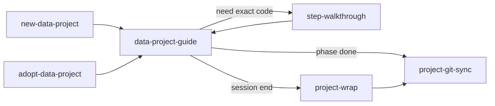

# data-project-skills

Six [Claude Code](https://claude.com/claude-code) skills that run a data analytics portfolio project from first idea to published repo. Every project gets the same folder layout, a phase checklist, a memory file that says exactly what to do next session, and a GitHub push when a phase is done.

Install: see [INSTALL.md](INSTALL.md).

## Contents

- [What the skills do](#what-the-skills-do)
- [What the project looks like](#what-the-project-looks-like)
- [How it fits together](#how-it-fits-together)
- [Calling a skill](#calling-a-skill)
- [How to use it](#how-to-use-it)
  - [1. Start a new project](#1-start-a-new-project)
  - [2. Come back and keep working](#2-come-back-and-keep-working)
  - [3. Fit a project you already started into this workflow](#3-fit-a-project-you-already-started-into-this-workflow)
  - [4. Get exact code for a step](#4-get-exact-code-for-a-step)
  - [5. End a session](#5-end-a-session)
  - [6. Push to GitHub](#6-push-to-github)
  - [7. Set a permanent projects folder](#7-set-a-permanent-projects-folder)
- [Design choices](#design-choices)
- [Repo layout](#repo-layout)
- [Requirements](#requirements)
- [License](#license)

## What the skills do

| Skill | Say something like | What it does |
| :-- | :-- | :-- |
| `new-data-project` | "new data project" | Interviews you, shows a projected output for approval, creates the project folder, sets up git and a private GitHub repo. Runs once per project. |
| `adopt-data-project` | "adopt this project" | Brings a project you already started into the same layout. Creates only missing files, ticks checklist steps it can prove are done, never overwrites. |
| `data-project-guide` | "continue my data project" | Starts each session with a status line, then coaches you through the current phase with a hard gate at each phase end. |
| `step-walkthrough` | "walk me through the next step" | Gives the exact code for one checklist step, which file it goes in, and what it does line by line. |
| `project-wrap` | "wrap up" | Ends a session: logs what you finished, ticks the checklist, writes the next step explicitly. |
| `project-git-sync` | "push this" | Commits and pushes when a phase completes. Warns about big data files. Asks before every push. |

## What the project looks like

`new-data-project` creates this:

```
my-project/
├── Project Files/
│   ├── Python/        notebooks and scripts
│   ├── data/          raw and cleaned data (gitignored)
│   └── other/         dashboards, exports, images
├── CHECKLIST.md       where you are: phases, one-action steps
├── CLAUDE.md          rules for Claude in this project
├── FEATURES.md        what the project is and its best parts
├── MEMORY.md          session log and the explicit next step
├── README.md          public explainer for GitHub
└── .gitignore
```

| File | Holds |
| :-- | :-- |
| `CHECKLIST.md` | Your personal tracker. Seven phases (Setup, EDA, Analysis, Visualization, README, Code Quality, Final Review). Each step is one action. Each phase has a "Done when". |
| `CLAUDE.md` | The project's business question, layout, session rules, git rules and guardrails. |
| `FEATURES.md` | High-level list of what the project includes and the most interesting parts. |
| `MEMORY.md` | After every session: steps finished, scope changes, and the next step by number. |
| `README.md` | Short explainer for GitHub readers and for you in six months. |

A step in `CHECKLIST.md` looks like this:

```markdown
## Phase 2 - EDA
- [x] 2.1 Answer: what does one row represent?
- [x] 2.2 Answer: which columns matter most to the business question?
- [ ] 2.3 Write your hypothesis going in

**Done when:** every step has a one-sentence written insight and you can say which hypotheses still hold.
```

And `MEMORY.md` always opens with the next move:

```markdown
## Next session
**Start at:** Phase 2, step 2.3 - Write your hypothesis going in
```

## How it fits together



## Calling a skill

Type a slash and the skill name. This is the reliable way. Anything after the name is passed to the skill as an optional argument, and Claude Code shows the hint as you type.

| Command               | Optional argument        | Example                                            |
| :-------------------- | :----------------------- | :------------------------------------------------- |
| `/new-data-project`   | `[project name]`         | `/new-data-project housing-prices`                 |
| `/adopt-data-project` | `[path to project]`      | `/adopt-data-project ~/project/{existing project}  |
| `/data-project-guide` | `[project name or path]` | `/data-project-guide telco-churn`                  |
| `/step-walkthrough`   | `[1-5 \| phase]`         | `/step-walkthrough 3` or `/step-walkthrough phase` |
| `/project-wrap`       | none                     | `/project-wrap`                                    |
| `/project-git-sync`   | none                     | `/project-git-sync`                                |

- **Skip the argument** and the skill asks for what it needs.
- **Installed as a plugin?** Skills are prefixed with the plugin name: `/data-project-skills:new-data-project`. Copy-installed skills use the short form above.
- **Plain language also works.** "new data project" or "adopt this project" will usually trigger the matching skill, but the slash form always does.

## How to use it

### 1. Start a new project

```
> new data project
```

Claude asks where to create it (default `~/projects`, or your saved folder), then one question at a time: your starting point, the business question, audience, dataset, what "done" looks like, three key questions, and what is out of scope. It pushes back if the business question is vague. You then approve a projected output (deliverables, hypotheses, what done looks like) before anything is created. It builds the folder, makes the first commit, and asks before creating a private GitHub repo.

### 2. Come back and keep working

```
> continue my data project
```

From inside the project folder, Claude reads `MEMORY.md`, `CHECKLIST.md` and `CLAUDE.md` and opens with: "You're on EDA. Last session: finished 2.1 and 2.2. Next: 2.3. Ready?" From any other folder it lists your projects and asks which one.

At the end of a phase it checks the "Done when", ticks the checklist, and runs `project-git-sync`.

### 3. Fit a project you already started into this workflow

```
> adopt this project
```

Claude reads the folder, proposes the business question from your README and notebooks, and builds a checklist. A step is ticked only when it finds proof (a data file, a runnable notebook, a written README section). You approve the list before it is saved. Existing files are never overwritten, and moving files into `Project Files/` is optional.

### 4. Get exact code for a step

```
> walk me through the next step
> walk me through the next 3 steps
> walk me through this phase
```

Each step comes with the goal, the file to put it in, the code, a line-by-line explanation, what output to expect, the likeliest error, and a one-line interview answer.

### 5. End a session

```
> wrap up
```

Claude proposes updates to `MEMORY.md` (steps done, scope changes, next step) and `CHECKLIST.md`, applies them after you approve, then offers a push.

### 6. Push to GitHub

```
> push this
```

Claude checks for files over 5 MB and anything in `data/`, shows the commit message and branch, and asks before pushing. Phase done: `phase 3: answer all three key questions`. Phase still open at session end: `session 2026-11-18: phase 3 in progress`. No force pushes, and it never changes repo visibility.

### 7. Set a permanent projects folder

The first time you create a project, Claude offers to save your folder. Or create the file yourself:

```json
// ~/.config/data-project-skills/config.json
{ "projects_root": "/Users/you/code/portfolio" }
```

If the file is missing or the folder no longer exists, the skills fall back to `~/projects` and ask. Nothing breaks.

## Design choices

- **Private repo first.** New repos are private. Going public is a step in Final Review.
- **One checklist.** `CHECKLIST.md` is the only tracker.
- **Evidence before ticks.** Steps are ticked on proof, not on "I think I did that".
- **Self-contained skills.** Each skill folder works if copied on its own. The two that need templates carry their own copy.
- **Ask before outward actions.** Creating a repo and pushing always ask first.

## Repo layout

```
data-project-skills/
├── .claude-plugin/        plugin and marketplace manifests
├── skills/
│   ├── new-data-project/  SKILL.md + templates/
│   ├── adopt-data-project/ SKILL.md + templates/
│   ├── data-project-guide/
│   ├── step-walkthrough/
│   ├── project-wrap/
│   └── project-git-sync/
├── scripts/
│   ├── install.sh         copy-install fallback
│   └── sync-templates.sh  keeps both templates folders identical
├── INSTALL.md
├── LICENSE
└── README.md
```

## Requirements

Claude Code, `git`, and the GitHub CLI (`gh`) logged in if you want repos created for you.

## License

MIT. See [LICENSE](LICENSE).
